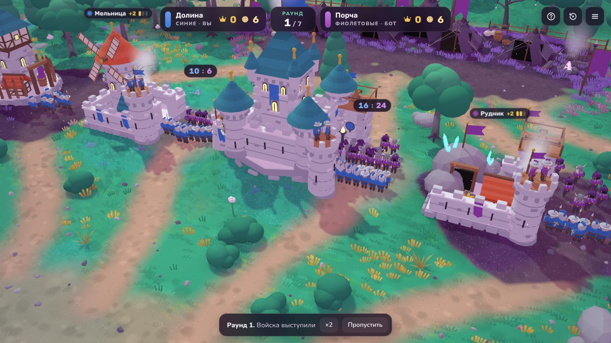
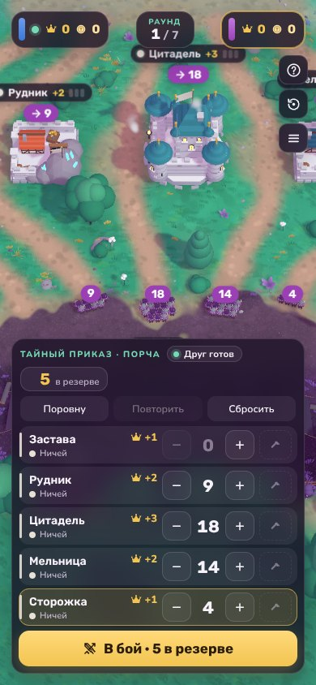

# Пять замков

Тактическая игра на двоих в стиле «Мятной долины». Каждый раунд вы тайно делите 50 воинов между пятью замками, а потом смотрите, кто кого перехитрил. Играть можно с ботом, вдвоём на одном экране или онлайн с другом по ссылке.

## Правила

- **Тайный приказ.** Каждый раунд у каждой стороны 50 воинов. Оба игрока одновременно раскладывают их по пяти замкам. Где воинов больше, тот и забрал замок. При ничьей замок остаётся у хозяина.
- **Ценность.** Замки стоят 1, 2, 3, 2 и 1. В конце раунда каждый замок приносит хозяину столько же золота и славы.
- **Башни.** Золото тратится на укрепления в своих замках. Башни стреляют по нападающим ещё до схватки, поэтому на укреплённый замок нужно больше войск. Захваченный замок теряет одну башню.

  | Укрепление | Цена | Сколько нападающих сбивают башни |
  |---|---|---|
  | Лучники | 3 золота | 4 |
  | Баллиста | ещё 5 золота | 9 |
  | Пушка | ещё 8 золота | 15 |

- **Победа.** После последнего раунда (их 5, 7 или 9) побеждает тот, у кого больше славы. При равенстве считают золото.

## Режимы

- **Против бота.** Бот запоминает, как вы распределяли войска в прошлых раундах, и пытается это использовать. Есть два уровня: «Новобранец» и «Полководец».
- **Вдвоём.** Два игрока на одном экране. Между ходами экран закрывается, чтобы второй игрок не подсмотрел приказ.
- **Онлайн с другом.** Создайте комнату и отправьте другу ссылку. Как только он её откроет, партия начнётся. Ещё друг может ввести шестизначный код комнаты в меню: «Онлайн с другом» → «Войти по коду».

## Как выложить на GitHub Pages

Git не понадобится, всё делается в браузере.

1. Войдите на [github.com](https://github.com) и создайте новый **публичный** репозиторий, например `five-castles`.
2. На странице репозитория нажмите **Add file → Upload files** и перетащите туда всё содержимое этой папки, вместе с папкой `lib`. Нажмите **Commit changes**.
3. Откройте **Settings → Pages**. В разделе **Build and deployment** выберите **Deploy from a branch**, ветку `main` и папку `/ (root)`, затем нажмите **Save**.
4. Через минуту-две игра откроется по адресу `https://ВАШ-ЛОГИН.github.io/five-castles/`. Этот адрес и нужно отправлять друзьям.
5. Проверьте онлайн: выберите «Онлайн с другом» → «Создать комнату» и откройте ссылку на комнату на телефоне или в другом браузере. Партия начнётся сама. Проверить можно и в соседней вкладке того же браузера: игра предложит занять там место второго игрока. После проверки создайте для друга новую комнату.

Чтобы у ссылки в Telegram и других мессенджерах появилась картинка, откройте `index.html` и замените `preview.jpg` в строке `og:image` на полный адрес, например `https://ВАШ-ЛОГИН.github.io/five-castles/preview.jpg`.

С компьютера игру можно открыть и двойным щелчком по `index.html`: бот и режим «вдвоём» работают и так. Онлайн тоже подключится, но ссылка на комнату будет вести на файл на вашем диске, поэтому для игры с другом нужен адрес в интернете.

## Как устроен онлайн

У GitHub Pages нет своего сервера, поэтому игроки обмениваются сообщениями через бесплатные публичные MQTT-брокеры: HiveMQ, EMQX и Mosquitto. Игра подключается ко всем трём сразу и шлёт сообщения через каждый, так что партия продолжается, даже если один из брокеров не работает.

- **Приказ не подсмотреть.** Сначала каждый отправляет только «печать» своего приказа (хеш SHA-256 со случайной солью). Сам приказ открывается, лишь когда оба запечатали свои. Если открытый приказ не совпадает с печатью, игра это заметит.
- **Чужие не вмешаются.** Адрес комнаты на брокере и подпись сообщений (HMAC) вычисляются из кода комнаты. Кто не знает код, не сможет ни войти, ни подделать ход.
- **Перезагрузка не страшна.** Ходы каждого игрока хранятся на брокерах и в браузере. После перезагрузки страницы или потери связи партия восстанавливается с того же места. Незаконченную партию можно продолжить из меню.

Ограничения:

- Публичные брокеры бесплатные и ничего не гарантируют. Обычно они работают стабильно, но могут ненадолго пропадать.
- Брокеры работают на портах 8884, 8084 и 8081. Некоторые школьные и офисные сети такие порты закрывают. Тогда помогает мобильный интернет.
- Продолжить партию можно только в том же браузере, где её начали, потому что ваш запечатанный приказ хранится там.

## Файлы

| Файл | Что внутри |
|---|---|
| `index.html` | страница игры |
| `style.css` | оформление |
| `game.js` | весь код игры: графика, правила, бот, онлайн |
| `lib/` | three.js r128, MQTT.js и шрифты Rubik и Nunito, чтобы игра не зависела от чужих CDN |
| `preview.jpg`, `screen-*.jpg` | картинки для ссылки и для этого описания |
| `.nojekyll` | просит GitHub Pages отдавать файлы как есть |

## Лицензии сторонних частей

three.js и MQTT.js распространяются по лицензии MIT, шрифты Rubik и Nunito — по SIL Open Font License 1.1. Тексты лицензий лежат в `lib/LICENSES.md`.
